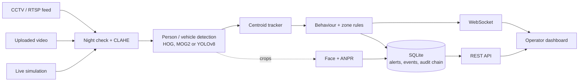

# IBVAP — Intelligent Border Video Analytics Platform

**AI video analytics for border and perimeter surveillance, running on the CCTV cameras that are already installed.**

IBVAP adds detection, tracking, behaviour alerts and a tamper-evident evidence trail to existing CCTV/RTSP feeds. No new camera hardware is needed.

**Live demo:** https://ibvap-rdie.onrender.com  (database viewer: https://ibvap-rdie.onrender.com/db-viewer). Ask the team for the API key. The free server sleeps when idle, so the first load can take up to a minute.

Built by **Team KavachX**:

| Member | Role |
|---|---|
| Swastik Mitra | Team leader; computer vision, detection, tracking and ANPR pipeline |
| Sunanda Samanta | Team member; frontend and operator dashboard |

Originally built for Smart India Hackathon 2026, problem statement **SIH26187** (Ministry of Home Affairs / Sashastra Seema Bal). The repo is codenamed `sentinel-grid`.

---

## The problem

Border posts already have CCTV, but the footage is mostly watched live or reviewed after an incident. One operator watching many screens gets tired and misses events, especially at night. There is no automatic tracking of a person or vehicle over time, and no proof that a recording or log was not altered later.

## What IBVAP does

| Capability | How it works |
|---|---|
| Person detection and tracking | HOG detector (or YOLOv8 if installed) + Hungarian-assignment centroid tracker with stable IDs |
| Vehicle detection and classification | MOG2 background subtraction (or YOLOv8 car/truck/bus/motorcycle classes) |
| Number plate recognition (ANPR) | Plate-region cascade + Tesseract OCR |
| Face detection | OpenCV Haar cascade on person crops (real video only) |
| Virtual fence intrusion | Direction-aware border-line crossing test, operator-calibrated zones |
| Suspicious activity | Loitering (dwell time), erratic motion, group/convoy formation (DBSCAN) |
| Night-time movement | Brightness classifier + CLAHE low-light enhancement |
| Real-time alerts | WebSocket live feed, acknowledge workflow, evidence snapshots, printable incident reports |
| Tamper-evident audit trail | SHA-256 hash-chained `audit_log`; a built-in demo runs real SQL tampering attacks and shows them being detected |
| Multi-source input | Live simulation, uploaded video replay, RTSP camera feeds |
| Cross-camera matching | Colour-histogram signatures to suggest the same object across cameras |
| Web database viewer | `/db-viewer` shows alerts, events, the audit trail and session stats in the browser |

Detection picks its backend automatically: lightweight CPU-only models by default, YOLOv8 when `ultralytics` is installed. The tracking and alert code is the same either way.

## Architecture



## Project layout

```
sentinel-grid/
├── backend/
│   ├── app/
│   │   ├── main.py            FastAPI app: REST, WebSockets, serves the dashboard
│   │   └── core/              detector, vehicle, tracker, anpr, face, night, zones,
│   │                          analytics, simulator, pipeline, replay, rtsp_source,
│   │                          cross_camera, storage (SQLite + audit chain)
│   ├── tests/test_core.py     unit tests
│   ├── requirements.txt
│   ├── setup.bat / run.bat    one-click Windows setup and start
│   └── SECURITY_NOTES.md
├── frontend/
│   ├── index.html             operator dashboard (single file, no build step)
│   └── db_viewer.html         read-only database viewer
├── docs/
│   └── RENDER_DEPLOYMENT.md   hosting guide
├── render.yaml                Render blueprint
└── docker-compose.yml
```

## Run it locally

Needs Python 3.12. For ANPR, also install [Tesseract OCR](https://github.com/UB-Mannheim/tesseract/wiki) (Windows) or `apt-get install tesseract-ocr` (Linux).

**Windows:** in `backend/`, run `setup.bat` once, then `run.bat`. The dashboard opens at http://localhost:8000.

**Any OS:**

```bash
cd backend
python -m venv .venv
source .venv/bin/activate        # Windows: .venv\Scripts\activate
pip install -r requirements.txt
export IBVAP_API_KEY=choose-a-key   # Windows: set IBVAP_API_KEY=choose-a-key
uvicorn app.main:app --host 0.0.0.0 --port 8000
```

Open http://localhost:8000 and enter the API key you set. API docs are at http://localhost:8000/docs.

Optional, for better accuracy: `pip install ultralytics`, then `pip install --force-reinstall opencv-python-headless==4.13.0.92` (ultralytics replaces OpenCV with a build that breaks the Haar cascades). `setup.bat` does this for you.

**Tests:**

```bash
cd backend
PYTHONPATH=. pytest tests -v
```

## Using the demo

1. Enter the API key.
2. Click **Live simulation** to run the scripted scenario: people and vehicles cross the virtual fence, loiter and group up, and alerts appear on the right.
3. Use **Upload & replay video** to run the same pipeline on your own video.
4. Open the **Audit Demo** panel: seed clean data, run either tampering attack, and watch the chain verification catch it.
5. Click **View Database** to browse the raw tables.

## Deployment

The app is one FastAPI service that also serves the dashboard, so it deploys as a single web service. `render.yaml` sets it up on Render's free tier with a randomly generated API key (find it under the service's **Environment** tab). See [docs/RENDER_DEPLOYMENT.md](docs/RENDER_DEPLOYMENT.md).

Free-tier caveats:
- The service sleeps after 15 minutes idle; the first request takes 30–60 seconds.
- Storage resets on every restart, so click **Seed Clean Demo Data** or run the simulation before showing it.
- The hosted version runs the CPU-only detectors. Tesseract is not installed there, so ANPR plate reading only works in a local install.

## Limitations

- HOG/MOG2 are the fallback detectors and produce false positives on busy outdoor footage. On one real test clip, spurious vehicle IDs dropped from 48 to 13 after enabling YOLOv8.
- Face detection finds faces; it does not identify people.
- Cross-camera matching uses colour histograms, not a trained re-identification model.
- SQLite is used for the prototype. The storage layer is plain SQL so it can move to PostgreSQL.
- Testing has been on real-world video clips, not at a live border post.
